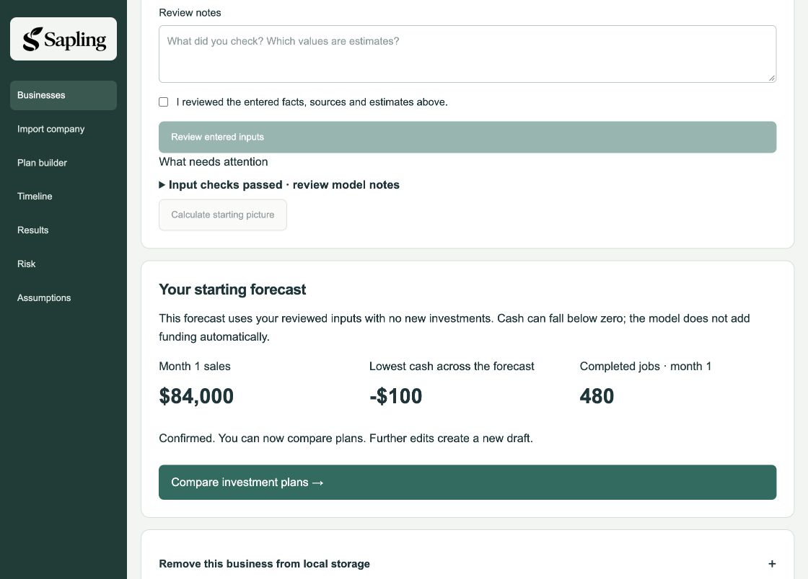
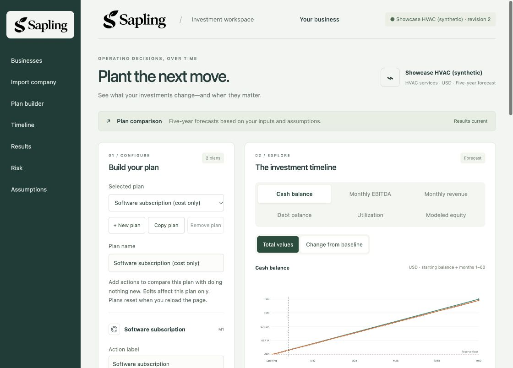
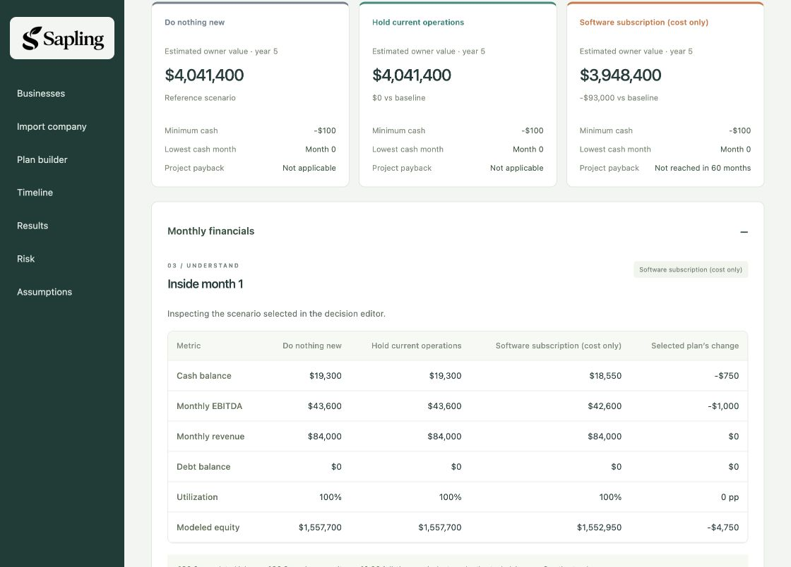
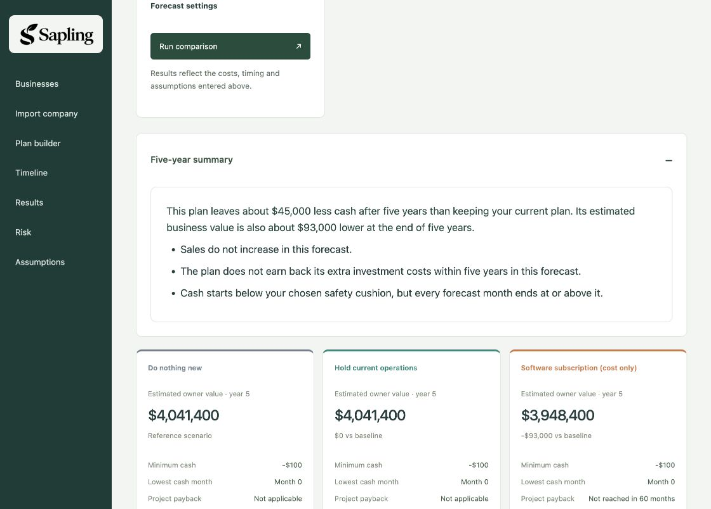
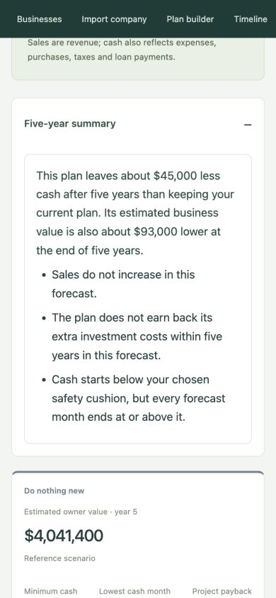

# Sapling selected-company demo fallback

Use these checked-in screenshots if the live demonstration is interrupted. They show a fictional company and modeled results. This is implementation-owner evidence; independent browser acceptance and the team's release decision remain open.

## Capture identity

- Host: Luke's macOS checkout, Node v24.4.0, built preview at `http://127.0.0.1:4182/`.
- Runtime: `bea8415`, including blank Plan A/B defaults and the opening-cash summary correction. Starting-forecast screenshot was captured at parent `f8b72ad`; its inputs and calculations are unchanged.
- Local confirmed profile: `b01847d9-c6fe-4536-87b0-bd42204f734a`, revision 2, “Showcase HVAC (synthetic)”. The ID belongs to this local browser/database, not a portable shared account.
- Selected workbook: `outputs/showcase-demo/showcase-company.xlsx`, SHA256 `11db0060e763103f84188be7fcd8731692dbed3d96f6ad0c1f914349776f32da`.
- Plan A: “Hold current operations”, no actions. Plan B: “Software subscription (cost only)”, only a $1,000/month operating expense labeled “Software subscription”, start month 1, duration 60. Baseline has no actions; reserve $1,000; exit multiple 4; horizon 60 months.

## Two-minute walkthrough

1. **Reviewed company inputs.** The selected workbook was previously imported, reviewed and confirmed. Reopening the saved business shows a starting forecast of $84,000 month-one sales and 480 completed jobs. Starting cash is -$100; the model supplies no automatic funding.
2. **Build two alternatives.** Plan A leaves operations unchanged. Plan B adds only the software cost. A label does not create a sales or productivity benefit. Editing marks old results stale; Run comparison refreshes them.
3. **Explain month one.** Sales remain $84,000 in all plans. Software reduces EBITDA from $43,600 to $42,600, and ending cash from $19,300 to $18,550. The $750 cash difference reflects the existing tax policy. Demand is 600 jobs against capacity of 480; completed jobs are 480, with 10 productive technicians and 8 active trucks.
4. **Explain five years.** Modeled owner value is $4,041,400 for baseline/Plan A and $3,948,400 for software, a $93,000 difference. That combines $48,000 less enterprise value and $45,000 less accumulated cash. Software payback is not reached within 60 months; the empty alternative has no qualifying investment to repay.
5. **Name the boundaries.** The -$100 minimum is the opening balance (month 0). All forward month-end cash balances meet the $1,000 reserve. Imported-company risk simulation remains unavailable; any separate fictional-business risk demonstration uses a different company and assumptions.

## Screenshot sequence

### Confirmed starting picture

### Company identity and selected plan

### Month-one financials and five-year owner values

### Concise five-year summary

### Narrow-screen summary (390 × 844)

## Rehearsal observations and restart recovery

Reopened the same confirmed profile through Businesses, followed Compare investment plans, entered the selected actions, ran the comparison and inspected the monthly table. Displayed values above matched the accepted selected-package checkpoints. The confirmed company also reopened successfully after stopping/restarting the built preview with the same private intake directory and browser cookies. Plan edits reset on reload, as the UI states; the selected plans were recreated and rerun after restart. No captured browser error logs; summary layout inspected at normal desktop size and 390px width, then viewport override reset.

If live plan edits disappear, reopen the saved confirmed company, rename Plan A, select Plan B, rename it, choose Operating expense, add the action, set its label and duration to 60 (default amount $1,000 and start month 1), and Run comparison. Verify reserve 1,000 / multiple 4 under Forecast settings. Move the month slider to 1 and open Monthly financials. Keep the tab open afterward.

Use [the runbook](DEMO_RUNBOOK.md) for startup and storage requirements. This company capture did not repeat workbook upload/review/confirmation from scratch, run company risk simulations, establish projector readability, approve a deployment, or close independent browser/release acceptance. P2's later fictional-business risk changes are integrated separately; [the risk integration record](PERSON_3_RISK_INTEGRATION.md) documents a real completed 100-path browser preview on this Mac. Imported-company risk remains unavailable.
