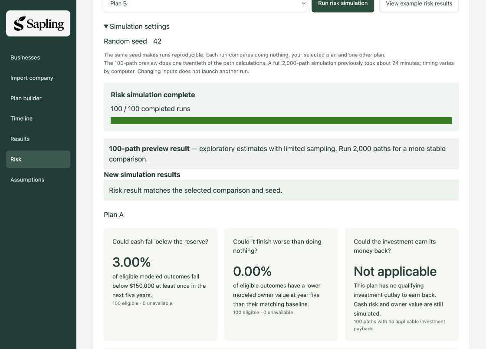

# P2 risk integration — supported-host browser check

Integrated `will 550de02` (including quick preview `41425f2`) into the current Sapling website at merge commit `5126a02`. Existing Plan A/B initialization, company intake page, global layout, deterministic explanations and screenshot fallback remain unchanged from `3337626`.

## Verified on the running website

macOS, Node v24.4.0, built preview at `http://127.0.0.1:4182/`, with `OPERATOROS_MC_REVIEW=1`. The same private intake directory and browser cookies were retained. This risk check uses the separate fictional example company, not the imported showcase company.

- Homepage starts with editable blank Plan A / Plan B, with Plan A selected. Baseline and both alternatives have no actions; reserve $150,000, exit multiple 6.
- Quick preview defaults to 100 paths; Full run offers 2,000 paths. Seed 42.
- Actual browser submission ran through the packaged worker and polling to **100 / 100 completed runs** and a matching result.
- Plan A cash-below-reserve estimate displayed 3.00% (100 eligible, zero unavailable); lower owner value than its paired baseline displayed 0.00%. Blank alternatives share baseline economics.
- Payback displayed **Not applicable**, with “This plan has no qualifying investment outlay to earn back. Cash risk and owner value are still simulated.” All 100 paths had no applicable investment payback.
- Year-five owner-value P10–P90 displayed $4,453,689–$11,748,583; median $7,706,870. These are rough synthetic preview estimates, not company-calibrated odds.
- Selecting Full run marked the completed preview stale; the displayed result retained its 100-path warning and total. No full job launched. Returning to Quick preview restored the matching-result status.
- No captured browser error logs. The completed comparison tab remains open; no restart/reload after this run.

## Validation and startup

`npm test`: **185 passed**, zero failures, including authoritative contract artifacts/types, frozen 61-state deterministic reference and the packaged worker. `npm run check`: zero errors/warnings. `npm run build`: app/worker pass. Diff check clean.

New simulations require `OPERATOROS_MC_REVIEW=1` in the running server environment. Stop the old server, rebuild/restart using the command in [DEMO_RUNBOOK.md](DEMO_RUNBOOK.md), then refresh. The flag is a local opt-in and does not activate imported-company risk. A push does not replace an already running server or deploy a hosted URL.

No full 2,000-path benchmark, imported-company risk activation, production deployment or joint release approval is claimed. This verifies the integrated 100-path flow on this Mac; independent final browser review and presentation-host/submission decisions remain separate.
